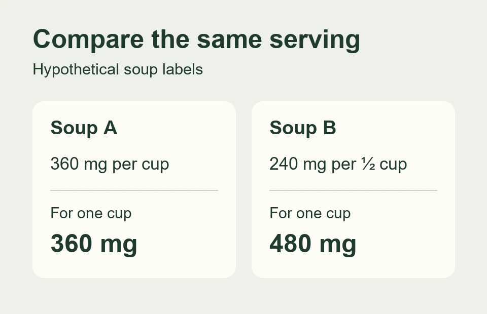

A turkey sandwich and a bowl of tomato soup can taste mild and still provide more sodium than you expect. The bread, turkey, mustard, and soup each contribute their own share. The saltshaker can stay on the shelf the whole time.

The [CDC reports that most sodium Americans consume comes from processed and restaurant foods](https://www.cdc.gov/salt/about/). The amount in a packaged food can vary by brand, recipe, and serving size. Start with something you eat often, and compare two options in the amount you actually use.

## 1. Bread and rolls

A slice of bread may taste mild, but toast at breakfast and a sandwich at lunch can make bread a regular source of sodium. Check whether the serving on each package is one slice, two slices, or a stated weight in grams.

**What to try:** Compare the sodium listed for one serving of two breads you already buy. Check that the serving sizes match before choosing between them.

You don't have to stop eating bread. You may simply discover that one similar option contains less sodium than another.

## 2. Deli turkey and ham

A turkey sandwich can feel like a straightforward lunch choice.

But packaged deli meats often contain added sodium as part of processing and preservation. The amount varies among products.

That means a sandwich made with turkey, cheese, bread, and condiments can contain sodium from several ingredients before you add anything else.

Here's a useful question to ask in the grocery aisle:

*Am I comparing the same amount of meat, or just two packages with different serving sizes?*

**What to try:** Look for lower-sodium versions of deli meats, then compare the Nutrition Facts panels.

For another lunch option, consider home-cooked poultry prepared without heavily salted seasonings.

You may find that changing one ingredient makes more sense than replacing the whole meal.

## 3. Canned soup

A can of soup may hold more than one serving. Check the number of servings in the container before deciding what the number on the label means for your bowl. If the label has a per-container column and you plan to eat the whole can, use that column.

You can also make a quick soup from no-salt-added ingredients and season it with herbs, garlic, or lemon.

**What to try**

Look at both the sodium per serving and the number of servings in the container.

Compare regular, reduced-sodium, and low-sodium varieties rather than assuming every soup in the same category is similar.

## 4. Pizza

Pizza isn't surprising because it contains cheese.

What's easier to overlook is how sodium can come from multiple parts of the same slice: crust, sauce, cheese, and toppings.

Pepperoni, sausage, and other processed meat toppings can add more.

Portion size matters, too. The amount listed for a serving may not match how much you actually eat.

You don't have to ban pizza from your life to pay attention to it.

**What to try:** Compare the nutrition information for different toppings and serving sizes when it's available.

At home, experiment with vegetables, smaller amounts of cheese, and less processed meat.

The goal isn't to turn a Friday-night favorite into a nutrition exam. It's to know what you're choosing.

## 5. Prepared chicken

Chicken often shows up on lists of foods for a balanced diet.

But there's an important difference between plain chicken you season yourself and a ready-to-eat or heavily processed chicken product.

Some packaged poultry products may contain added salt or solutions used during processing.

Breaded chicken, frozen entrées, and restaurant preparations can have very different sodium amounts from plain poultry.

The word *chicken* alone doesn't tell you enough.

**What to try:** For packaged products, read the ingredient list and Nutrition Facts panel.

If you're buying fresh poultry, check whether the label mentions an added solution.

For meals you prepare at home, try building flavor with herbs, citrus, and spices rather than relying only on salty seasoning blends.

## 6. Sandwiches

A sandwich isn't a single ingredient.

It's a combination of bread, protein, cheese, spreads, sauces, and sometimes pickled vegetables.

Each component may contribute sodium.

That's why a sandwich can be worth checking even when none of its ingredients seems especially salty on its own.

Consider a familiar lunch:

<ul class="article-ingredients" role="list">
<li>Two slices of bread</li>
<li>Deli turkey</li>
<li>Cheese</li>
<li>Mustard</li>
</ul>

You might not add a grain of salt, yet sodium can come from every part of that meal.

**What to try:** Change one component at a time.

Compare breads, use a different filling, choose a lower-sodium condiment, or add vegetables for flavor and texture.

You don't have to reinvent lunch to make it more intentional.

## 7. Bottled sauces and dressings

A bottle of sauce can make a simple meal taste better in seconds.

But sodium levels can vary widely among condiments, marinades, and salad dressings.

A tablespoon or two may seem insignificant until you notice how often the same product appears in your meals.

This doesn't mean every dressing or sauce is high in sodium. It means the label is worth checking.

**What to try:** Compare two products you use for the same purpose.

Pay attention to how much you usually pour, not just the listed serving size.

For some meals, olive oil, vinegar, citrus, herbs, and spices can provide flavor without relying on the same bottled sauce every time.

## How to compare two labels

You don't have to memorize sodium amounts for every food.

The FDA's Nutrition Facts guidance gives you a straightforward place to start: the Percent Daily Value, or **%DV**.

As a general guide for a single serving:

- **5% DV or less** of sodium is considered low.
- **20% DV or more** is considered high.

For products between those points, you can still compare the sodium listed in milligrams.

Try this three-step comparison.

1. **Match the quantities.** Compare the same weight or volume when the stated servings differ.
2. **Read sodium in milligrams.** Use the amount for the matched quantity.
3. **Adjust for your portion.** Multiply the sodium per serving by the number of servings you plan to eat.

### Example: What if the cans list different serving sizes?

Suppose soup A lists 360 mg per cup and soup B lists 240 mg per half cup. To compare a one-cup bowl, double soup B’s number. That gives you **360 mg for soup A and 480 mg for soup B**. These numbers are hypothetical. On a real package, check the stated weight or volume when converting.

A food with a modest sodium figure per serving can contribute more if your portion is several servings.

The FDA explains that “reduced sodium” means at least 25% less sodium than the regular product. Check the milligrams on the Nutrition Facts panel to see how the amount compares with your other options.

The label helps you compare. Your usual portion helps you put that comparison into context.

## One change to try this week

It's easy to read about sodium and decide that the entire refrigerator needs an overhaul.

But consider a smaller approach.

On your next grocery trip, choose just one category from this list.

Maybe it's the bread you buy every week. Maybe it's soup, turkey slices, or the dressing you reach for without thinking.

Compare two options.

If one meets your needs, tastes good, fits your budget, and contains less sodium, you've found a practical change you can repeat.

You can also think about the bigger pattern of your meals.

The [NHLBI overview of DASH](https://www.nhlbi.nih.gov/health/dash-eating-plan) describes an eating pattern that emphasizes vegetables, fruit, whole grains, and other everyday foods. It also gives examples of ways to compare groceries and season meals.

## Grocery checklist

Before putting a packaged food in your cart, ask:

- Is the serving size similar to the amount I actually eat?
- How much sodium is listed per serving?
- Is there another version with less sodium?
- Will I enjoy the alternative enough to buy it again?
- Does it fit the way I normally prepare meals?

If you only have time for one comparison, pick the food you buy most often. Save a photo of the label or jot down your preferred option so you can find it next time.

## Sources

- [FDA — Sodium in Your Diet](https://www.fda.gov/food/nutrition-education-resources-materials/sodium-your-diet)
- [FDA — How to Understand and Use the Nutrition Facts Label](https://www.fda.gov/food/nutrition-facts-label/how-understand-and-use-nutrition-facts-label)
- [CDC — About Sodium and Health](https://www.cdc.gov/salt/about/)
- [American Heart Association — Sodium and Salt](https://www.heart.org/en/healthy-living/healthy-eating/eat-smart/sodium/sodium-and-salt)
- [NHLBI — DASH Eating Plan](https://www.nhlbi.nih.gov/health/dash-eating-plan)
